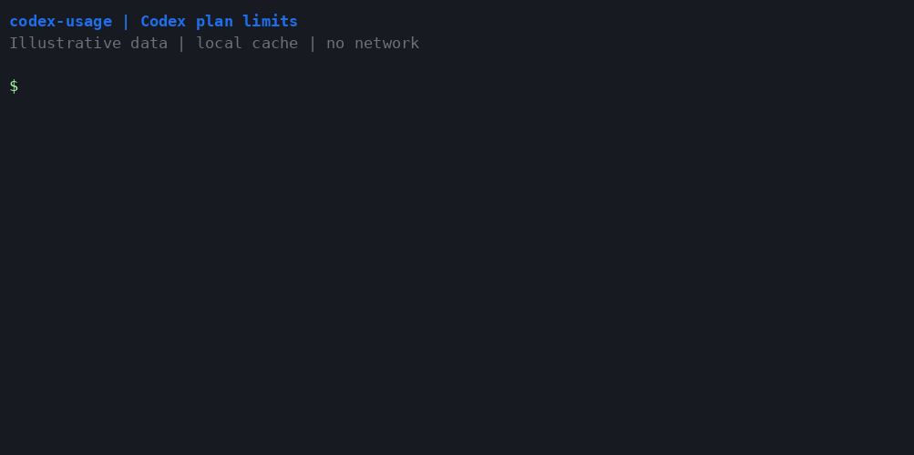

<h1 align="center">📊 codex-usage</h1>

<p align="center">
  <b>Your Codex plan limits — right from your terminal.</b>
</p>

<p align="center">
  <a href="https://pypi.org/project/codex-usage-limits/"></a>
  
  
  
  
</p>

<p align="center">
  
</p>

---

Codex shows your plan limits only in the interactive `/status` screen.
**`codex-usage` gives you plan usage from the shell** — for scripts, hooks, and
AI agents deciding when to back off. It uses the Codex login already on your
machine.

The 5-hour window appears when your plan has one and the usage source reports
it. Some plans have weekly limits only.

**Install `codex-usage-limits` from PyPI. The command is `codex-usage`.**

```text
$ codex-usage
7-day: 59% used, resets Sun 03:00 (in 12h29m)
```

## ✨ Features

- **Usage windows** — 5-hour and weekly usage when available, additional limits, and local reset times.
- **🚦 Thresholds for scripts** — `--warn [N]` checks any usage window. `--warn-7d [N]` checks the main weekly window. Both exit 1 at or above N%.
- **📊 Extra detail** — `--all` shows limit status, code-review usage, and the plan and credits when available.
- **📜 Session logs** — a local fallback when the endpoint and its saved answer are unavailable.
- **🧾 Plain, JSON, or short** — readable in a terminal and easy to use from scripts.
- **🌍 Cross-platform** — macOS, Linux, and Windows with Python 3.9+.
- **🔋 Zero dependencies** — pure Python standard library.
- **🔒 Local & private** — reads your existing login and sends the token only to ChatGPT.

## 🚀 Quickstart

```bash
pip install codex-usage-limits
codex-usage
```

Sign in with ChatGPT using `codex login` on this machine first. Open `codex` if
the access token needs to refresh.

## 🧑‍💻 Usage

| Command | What it does |
|---|---|
| `codex-usage` | Available usage windows and their reset times |
| `codex-usage --json` | Raw usage JSON with identity fields removed (alias for `--format json`) |
| `codex-usage --warn [N]` | Exit 1 when any usage window reaches N% (default 70) |
| `codex-usage --warn-7d [N]` | Exit 1 at or above N% of the main 7-day window (default 70) |
| `codex-usage --all` | Add per-limit details and the account summary in plain format |
| `codex-usage --format {plain,json,short}` | Choose output format (default plain) |
| `codex-usage -v`, `--verbose` | Print credential and usage sources and the plan, when available, to stderr |
| `codex-usage -V`, `--version` | Print the version |
| `codex-usage -h`, `--help` | Show help |

Flags combine. For example, run `codex-usage --format short --warn 70 --warn-7d 90`.
`--json` and `--format` set the same option, and the last one wins. `--all` adds
detail in plain format.

<details>
<summary><b>📊 Example <code>--all</code> output</b></summary>

```text
5-hour: 23% used, resets 14:00 (in 2h41m)
7-day: 59% used, resets Sun 03:00 (in 15h41m)
limit          window   percent  status     reset
------------------------------------------------------------------------------
codex          5-hour       23%  allowed    resets 14:00 (in 2h41m)
codex          7-day        59%  allowed    resets Sun 03:00 (in 15h41m)
code review    7-day         4%  allowed    resets Sun 03:00 (in 15h41m)
plan pro · credits 0 · reset credits 2 available
```

Detail fields depend on the account and endpoint response. With a session-log
answer, the CLI adds `(details not available from the session-log source)`.
</details>

## 🤖 Using it from scripts and agents

```bash
codex-usage --warn 70 || echo "back off"
codex-usage --warn 70 --warn-7d 90 --format short
codex-usage --json
```

The usual output is printed even when a threshold trips. Exit codes are **0**
for success, **1** when a threshold trips or no source answers, and **2** for an
argument error. Thresholds are inclusive, so `--warn` exits 1 at exactly 70%.
Missing or null windows are skipped. `--warn` includes additional usage limits,
and `--warn-7d` checks only the main 7-day window. Code-review limits appear
under `--all`.

## 📜 Codex session logs

Codex records rate-limit snapshots in `~/.codex/sessions/YYYY/MM/DD/rollout-*.jsonl`
while you use it. When the endpoint and saved answer are unavailable, the CLI
reads the last Codex rate-limit snapshot from the newest session log. It uses
the event time to show the age and leaves out windows whose reset time has passed.

```text
$ codex-usage
5-hour: 23% used, resets 14:00 (in 2h41m)
7-day: 59% used, resets Sun 03:00 (in 15h41m)
(from the session log, 3 min ago)
```

With `--format short`, a session-log answer includes the model when available.

```text
gpt-6.2-sol · 5h 23% · 7d 59%
```

## 🤔 How it works

Sources are tried in this order.

1. `last-usage.json` if less than **5 minutes** old.
2. One live `GET https://chatgpt.com/backend-api/wham/usage`, saved on success.
3. `last-usage.json` if less than **60 minutes** old.
4. The newest Codex session log if its selected usage event is less than **60 minutes** old.

The cache and logs live in `~/.codex`, or `CODEX_HOME` when set. Cache writes
are atomic. Cached answers at least a minute old show their source and age, for
example `(from the endpoint, 3 min ago)`. Session-log answers always show their
age in plain output. If every source fails, the distinct reasons appear once
each on stderr.

Five-minute reuse avoids repeating requests. The single request times out
after 15 seconds and the CLI never polls or retries.

<details>
<summary><b>🔍 Where credentials live (per OS)</b></summary>

The CLI looks for credentials in this order.

1. `CODEX_ACCESS_TOKEN` environment override, used as-is. Set `CODEX_ACCOUNT_ID`
   to override the account ID from the token.
2. The `auth.json` credentials file.
3. macOS Keychain service **`Codex Auth`**, read with
   `security find-generic-password -s "Codex Auth" -w` when the file is missing.

| OS | Credentials file |
|---|---|
| macOS / Linux | `~/.codex/auth.json` |
| Windows | `%USERPROFILE%\.codex\auth.json` |

`CODEX_HOME` changes the credentials, cache, and session-log paths. The token is
`tokens.access_token`. If the token has expired, open `codex` so it refreshes.

For the protocol and a recipe to rebuild the tool, see
**[docs/HOW_THIS_WAS_BUILT.md](docs/HOW_THIS_WAS_BUILT.md)**.
</details>

## 🔒 Privacy & security

- Reads existing credentials and session logs. Codex handles token refresh.
- Sends the token only to **`chatgpt.com`**, with the usage request.
- Removes `email`, `user_id`, and `account_id` before writing the cache or printing JSON.
- Keeps tokens, request headers, and identities out of errors and verbose output.
- **No telemetry or third-party calls.**

## ⚠️ Good to know

- The usage endpoint is **undocumented**. Codex itself calls it, and the format may change.
- API-key logins have no ChatGPT plan limits. Use `codex login` to sign in with ChatGPT.
- Session logs update only while Codex runs. Old readings and reset windows age out.
- Plans differ. Some report a 5-hour and a weekly window, while others report only the weekly window.

## 🛠️ Install options

```bash
pip install codex-usage-limits        # from PyPI
pipx install codex-usage-limits       # isolated command installation
pip install .                        # from a local clone
```

Requires Python 3.9+. The PyPI distribution is **`codex-usage-limits`** because
`codex-usage` is taken on PyPI. The command and GitHub repo are `codex-usage`,
and the import package is `codex_usage`.

## 🤝 Contributing

Issues and PRs are welcome. After installing the local project with `pip install -e .`,
run the tests with:

```bash
pip install pytest && pytest -q
```

Tests use temporary config directories and mocked HTTP. They never contact the
endpoint or read your real credentials.

Regenerate the demo with `python3 docs/record_demo.py` after installing
[agg](https://github.com/asciinema/agg/releases) and the DejaVu Sans Mono font. The
recorder runs the CLI against an illustrative cache and session log with network
access disabled; it needs no credentials. The README embeds the resulting `docs/demo.gif`.

## 📄 License

[MIT](LICENSE) — do whatever you like.
